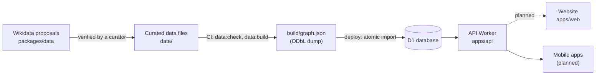

# Architecture

The service answers one question: is this brand, product or company
owned, part-owned, licensed or controlled, at any level of the chain, by a
company on the curated list? Every link in the answer carries a source,
and the answer depends on the date and country it is asked for.

The graph is built top-down: curators start from each listed company and
record its subsidiaries, stakes and brands. A lookup succeeds by reaching
something already in the graph; a brand that is not in the graph is
reported as unknown, never as "clean".

## Components

| Component                             | State                                              | Decided in                                             |
| ------------------------------------- | -------------------------------------------------- | ------------------------------------------------------ |
| Website (`apps/web`)                  | Placeholder page                                   | [ADR 5](adr/0005-react-router-on-workers.md)           |
| API Worker (`apps/api`)               | Search, lookup, nodes and criteria ([API](api.md)) | [ADR 11](adr/0011-d1-as-a-loaded-copy-of-the-graph.md) |
| D1 database                           | Reloaded from the built graph on every deploy      | [ADR 11](adr/0011-d1-as-a-loaded-copy-of-the-graph.md) |
| Curated data files (`data/`)          | Ownership for 21 groups; no listings yet           | [ADR 4](adr/0004-curated-data-in-git.md)               |
| Data model package (`packages/model`) | Used by the data tools and the API                 | [ADR 10](adr/0010-relationship-graph-data-model.md)    |
| Data tools (`packages/data`)          | Check, build and Wikidata proposals                | [ADR 4](adr/0004-curated-data-in-git.md)               |
| Mobile apps                           | Planned                                            | [ADR 6](adr/0006-expo-for-mobile.md)                   |
| Published data dump                   | Planned                                            | [ADR 9](adr/0009-licence-code-agpl-data-odbl.md)       |

The website does not yet call the API; it will once there is data to
show.

## Hosting

Both Workers run on Cloudflare (ADR 3) and are deployed by GitHub Actions
from `master` once all checks pass (ADR 8). Dashed links in the diagram are
planned, not yet built.
